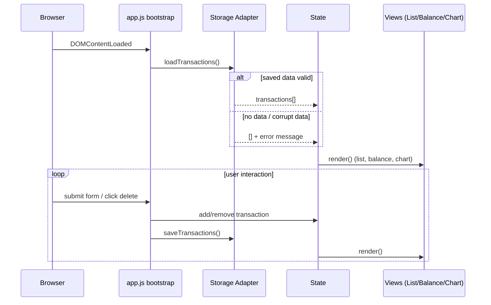

# Design Document

## Overview

The Expense & Budget Visualizer is a fully client-side web application that lets a user record expense transactions and understand spending at a glance. The user adds transactions (item name, amount, category) through an input form, reviews them in a scrollable list, sees a running total balance at the top of the page, and inspects a pie chart that breaks spending down by category. All data is persisted in the browser via the Local Storage API, so the application runs entirely client-side with no backend server.

This document describes the technical architecture, components and interfaces, data models, correctness properties, error handling, and testing strategy for the feature. The implementation is constrained to HTML for structure, a single CSS file in `css/` for styling, and a single JavaScript file in `js/` for behavior (vanilla JavaScript, no frameworks), with Chart.js used only as the Chart_Library to render the pie chart.

### Design Goals

- **Single source of truth**: An in-memory transaction list drives every view (list, balance, chart) and is the only thing persisted.
- **Pure logic, isolated from the DOM**: Validation, serialization, balance calculation, and category aggregation are pure functions with no side effects, so they can be unit-tested and property-tested in isolation.
- **Resilient persistence**: Every Local Storage access is wrapped in defensive error handling so quota limits, private-browsing mode, and corrupt data never crash the app.
- **Single-file constraint compliance**: All application behavior lives in one `js/app.js` file; test files live outside `js/` and are not counted.
- **Cross-browser correctness**: Only broadly supported web APIs are used, with feature-detection fallbacks where needed.

## Architecture

The application follows a one-way data-flow (model → view) architecture with a single in-memory state object as the source of truth. There is no framework, so the architecture is expressed as a small set of cooperating plain-JavaScript modules that all live inside the single `js/app.js` file.

### High-Level Data Flow

```mermaid
flowchart LR
    User([User]) -->|submit form / click delete| Controller
    Controller -->|validate| Validator
    Validator -->|valid Transaction| Controller
    Controller -->|mutate| State[(State<br/>transactions: Transaction[])]
    State -->|render list| ListView[Transaction List View]
    State -->|sum amounts| BalanceView[Balance View]
    State -->|aggregate by category| ChartView[Chart View]
    Controller -->|persist| Storage[Storage Adapter]
    Storage -->|try/catch| LocalStore[(localStorage)]
    LocalStore -->|load on startup| State
```

### Application Lifecycle



### Key Architectural Decisions

1. **One-way data flow with a central state.** A single `state.transactions` array is the source of truth. All mutations go through a controller that (a) validates, (b) mutates state, (c) persists, and (d) re-renders. This keeps the three views (list, balance, chart) consistent and avoids out-of-sync bugs. Rationale: with no framework, a single render path is the simplest way to guarantee Requirement 3.2 and 4.2 (balance and chart update together, without page reload).

2. **Pure logic separated from the DOM.** Validation, serialization/deserialization, balance calculation, and category aggregation are pure functions with no DOM or storage access. Rationale: these functions carry the correctness-critical behavior (Requirements 1, 5.3, 3, 4) and are the natural targets for property-based testing. Keeping them pure also makes the DOM-dependent code thin and easy to reason about.

3. **Single JS file with conditional exports.** `js/app.js` declares the pure functions at module top level, then guards all DOM/bootstrap code behind `if (typeof document !== 'undefined')` and conditionally exposes the pure functions via `module.exports` when running under Node (`if (typeof module !== 'undefined' && module.exports)`). Rationale: this satisfies Requirement 6.3 (exactly one JavaScript file in `js/`) while letting the Node-based property tests import the pure functions directly. The browser sees only the app; Node sees only the exports.

4. **Chart.js via CDN, update in place.** Chart.js is loaded through a pinned-version CDN `<script>` tag (it is the Chart_Library, excluded from the single-file constraint). The chart is created once and updated in place with `chart.update()` for incremental changes; it is `destroy()`ed and recreated only when switching between the "no data" placeholder and the actual chart. Rationale: avoids the known stale-value bug that occurs when a new `Chart` instance is created on an already-bound canvas without destroying the previous one, and keeps updates within the 200 ms performance budget (Requirement 8.1).

5. **Defensive storage adapter.** A thin `Storage` module wraps every `localStorage.getItem`, `localStorage.setItem`, and `JSON.parse` call in try/catch and returns a result object (`{ ok, value, error }`) instead of throwing. Rationale: `setItem` can throw `QuotaExceededError` (notably in Safari private mode) and `JSON.parse` throws on corrupt data; the adapter turns these into handled error messages per Requirements 5.5 and 5.6.

6. **Render-on-mutation, not on a timer.** Views re-render only when the controller mutates state (add/delete) or on initial load. Rationale: avoids wasted work and keeps the update path deterministic and fast.

## Components and Interfaces

All components below live in the single file `js/app.js`. They are described as logical modules. The DOM-dependent components require a `document` object; the pure logic components do not.

### Pure Logic Components (no DOM, no storage)

#### Validator

Validates raw form input against Requirement 1 and Requirement 10.

```javascript
/**
 * @typedef {Object} RawInput
 * @property {string} itemName  - raw text from the Item_Name field
 * @property {string} amount    - raw text from the Amount field
 * @property {string} category  - raw text from the Category selector ("" if none selected)
 */

/**
 * @typedef {Object} ValidationResult
 * @property {boolean} valid
 * @property {Object} errors - map of fieldName -> message; empty when valid
 * @property {Object|null} transaction - normalized Transaction when valid, else null
 */

/**
 * Validate raw form input and normalize it into a Transaction when valid.
 * Rules:
 *   itemName: trimmed length must be 1..100 (whitespace-only is invalid)
 *   amount:   must parse to a finite number > 0
 *   category: must be one of "Food" | "Transport" | "Fun" (no pre-selection => "" is invalid)
 * @param {RawInput} input
 * @returns {ValidationResult}
 */
function validateTransaction(input) { /* ... */ }
```

#### Transaction Factory

```javascript
/**
 * Create a Transaction from validated input, assigning a unique id.
 * @param {RawInput} normalizedInput - input that has already passed validation
 * @returns {Transaction}
 */
function createTransaction(input) { /* ... */ }

/**
 * Generate a unique id. Uses crypto.randomUUID() when available,
 * otherwise a timestamp + random fallback for older browsers.
 * @returns {string}
 */
function generateId() { /* ... */ }
```

#### Storage Codec (pure)

Pure serialization and deserialization. Deserialization also validates stored structure so corrupt data is detected (Requirement 5.6).

```javascript
/**
 * Serialize a transaction list to a JSON string for storage.
 * @param {Transaction[]} transactions
 * @returns {string}
 */
function serializeTransactions(transactions) { /* JSON.stringify */ }

/**
 * Deserialize a stored JSON string back into a transaction list.
 * Returns a Result: on failure (bad JSON or invalid structure) reports an error.
 * @param {string} raw
 * @returns {{ ok: true, transactions: Transaction[] } | { ok: false, error: string }}
 */
function deserializeTransactions(raw) { /* JSON.parse + structural validation */ }
```

#### Calculators (pure)

```javascript
/**
 * Compute the total balance as the sum of all transaction amounts.
 * @param {Transaction[]} transactions
 * @returns {number}  // rounded to 2 decimal places for display
 */
function calculateBalance(transactions) { /* ... */ }

/**
 * Aggregate transaction amounts by category.
 * @param {Transaction[]} transactions
 * @returns {Array<{ category: string, amount: number }>}
 *   // one entry per category that has >= 1 transaction, amount = sum of that category's amounts
 */
function aggregateByCategory(transactions) { /* ... */ }
```

### State

A single in-memory store. It is the single source of truth.

```javascript
/**
 * @typedef {Object} AppState
 * @property {Transaction[]} transactions
 */

const state = { transactions: [] };
```

### Storage Adapter (DOM/storage dependent)

Wraps `localStorage` with defensive error handling. All calls are try/catch guarded.

```javascript
const STORAGE_KEY = "expense-visualizer:transactions";

/**
 * Load transactions from localStorage.
 * @returns {{ transactions: Transaction[], error: string|null }}
 *   - error is null on success (including "no data => empty list")
 *   - error is set when data is corrupt; transactions is [] in that case
 */
function loadTransactions() { /* try/catch getItem + deserialize */ }

/**
 * Persist transactions to localStorage.
 * @param {Transaction[]} transactions
 * @returns {{ ok: boolean, error: string|null }}
 *   - on failure (QuotaExceededError / unavailable storage) ok=false, error set,
 *     and the in-memory list is NOT modified (Requirement 5.5)
 */
function saveTransactions(transactions) { /* try/catch setItem */ }
```

### Views (DOM dependent)

Each view exposes a `render(state)` function that updates its DOM node from the current state.

```javascript
/**
 * Render the transaction list into its container.
 * - One row per transaction showing Item_Name, Amount, Category, and a delete control.
 * - Container is scrollable when content overflows (CSS handles overflow).
 * - Shows no rows (and an optional empty-state hint) when transactions is empty.
 */
function renderTransactionList(transactions) { /* ... */ }

/**
 * Update the balance display at the top of the page.
 */
function renderBalance(transactions) { /* ... */ }

/**
 * Render or update the pie chart via Chart.js.
 * - One slice per category with >= 1 transaction, labeled by category name.
 * - Shows a "no spending data" placeholder when transactions is empty.
 */
function renderChart(transactions) { /* ... */ }
```

A single `render()` orchestrator calls all three so they stay in sync:

```javascript
function render() {
  renderTransactionList(state.transactions);
  renderBalance(state.transactions);
  renderChart(state.transactions);
}
```

### Controller (DOM dependent)

Wires DOM events to state mutations. Every handler validates, mutates, persists, and re-renders.

```javascript
/**
 * Handle Transaction_Form submission:
 *   validate -> on valid: create, push to state, persist, render
 *               on invalid: show validation messages, do NOT mutate state
 */
function handleSubmit(event) { /* ... */ }

/**
 * Handle a delete control click for a given transaction id:
 *   filter it out of state, persist, render
 */
function handleDelete(transactionId) { /* ... */ }

/**
 * Bootstrap: on DOMContentLoaded, load from storage, then render.
 */
function init() { /* ... */ }
```

### HTML Structure

A single `index.html` provides the static structure. The form, list, balance, and chart regions are fixed containers that the views populate.

```html
<!DOCTYPE html>
<html lang="en">
  <head>
    <meta charset="UTF-8" />
    <meta name="viewport" content="width=device-width, initial-scale=1.0" />
    <title>Expense &amp; Budget Visualizer</title>
    <link rel="stylesheet" href="css/style.css" />
    <!-- Chart_Library (CDN, pinned major version) -->
    <script src="https://cdn.jsdelivr.net/npm/chart.js@4.4.1/dist/chart.umd.min.js"></script>
  </head>
  <body>
    <header>
      <h1>Expense &amp; Budget Visualizer</h1>
      <section id="balance-display"><!-- Balance_View populated by JS --></section>
    </header>
    <main>
      <section id="transaction-form">
        <!-- Transaction_Form: itemName input, amount input, category select, submit button -->
      </section>
      <section id="transaction-list">
        <!-- Transaction_List: scrollable container populated by JS -->
      </section>
      <section id="category-chart">
        <canvas id="pie-chart"></canvas>
      </section>
    </main>
    <!-- Application behavior (single JS file in js/) -->
    <script src="js/app.js" defer></script>
  </body>
</html>
```

### CSS Structure

A single file `css/style.css`. It enforces the visual design rules (Requirement 9) and the scrollable list (Requirement 2.2).

```css
:root {
  --font-body: 16px;          /* Requirement 9.1: body text >= 16px */
  --font-h2: 20px;             /* Requirement 9.2: heading >= body + 4px */
  --font-h1: 24px;
}
body { font-size: var(--font-body); }
h1 { font-size: var(--font-h1); }
h2 { font-size: var(--font-h2); }

#transaction-list {
  max-height: 320px;          /* fixed height so content overflows */
  overflow-y: auto;           /* Requirement 2.2: scrolling when list exceeds view */
}
```

## Data Models

### Transaction

The core domain object. All user-facing requirements operate on this shape.

```javascript
/**
 * @typedef {Object} Transaction
 * @property {string} id        - unique identifier (used to target delete); survives round-trip
 * @property {string} itemName   - trimmed label, length 1..100
 * @property {number} amount     - monetary value, finite and > 0
 * @property {string} category   - one of "Food" | "Transport" | "Fun"
 */
```

Notes:
- `id` is an implementation detail (needed to target delete); it is generated on creation and is not part of the user-facing validation, but it must survive the storage round-trip.
- `itemName` is stored trimmed; validation rejects whitespace-only values, so a stored `itemName` is always 1..100 non-whitespace-only characters.
- `amount` is stored as a JavaScript number (finite, > 0). Display values are rounded to 2 decimal places to avoid floating-point artifacts.

### RawInput

Raw, unvalidated strings straight from the form fields.

```javascript
/**
 * @typedef {Object} RawInput
 * @property {string} itemName   // raw, possibly empty/whitespace
 * @property {string} amount     // raw, possibly non-numeric/empty
 * @property {string} category   // "" when no Category is selected (Requirement 10.3)
 */
```

### ValidationResult

Result of validating a `RawInput`.

```javascript
/**
 * @typedef {Object} ValidationResult
 * @property {boolean} valid
 * @property {Object<string,string>} errors  // fieldName -> message
 * @property {Transaction|null} transaction  // normalized Transaction when valid
 */
```

### Storage Schema

Transactions are persisted as a JSON array under a single localStorage key.

- **Key:** `expense-visualizer:transactions`
- **Value:** `string`, a JSON array of `Transaction` objects, e.g.:

```json
[
  { "id": "a1b2...", "itemName": "Lunch", "amount": 12.5, "category": "Food" },
  { "id": "c3d4...", "itemName": "Bus fare", "amount": 3.0, "category": "Transport" }
]
```

Order is the array order and is preserved across the save/load round-trip (Requirement 5.3).

### Structural Validation of Stored Data

`deserializeTransactions` accepts a string as valid only if:
1. It parses as JSON without throwing, **and**
2. The result is an array, **and**
3. Every element is an object with exactly the `Transaction` fields of the correct types:
   - `id`: string
   - `itemName`: string with trimmed length 1..100
   - `amount`: finite number > 0
   - `category`: one of `"Food"` | `"Transport"` | `"Fun"`

Any deviation returns `{ ok: false, error }`, which the storage adapter surfaces as a corrupt-data error message and initializes the app with an empty list (Requirement 5.6).


## Correctness Properties

*A property is a characteristic or behavior that should hold true across all valid executions of a system-essentially, a formal statement about what the system should do. Properties serve as the bridge between human-readable specifications and machine-verifiable correctness guarantees.*

The following properties apply to the pure logic layer of the application (validation, the storage codec, balance calculation, category aggregation, and list deletion). DOM rendering, localStorage I/O, browser compatibility, performance, and CSS are validated by example-based, integration, and smoke tests as described in the Testing Strategy, and are intentionally not expressed as properties because their behavior does not vary meaningfully with input or is side-effect/IO-bound.

### Property 1: Validation accepts all valid input and preserves the selected category

*For any* raw input whose trimmed `itemName` has length 1..100, whose `amount` parses to a finite number greater than zero, and whose `category` is exactly one of `Food`, `Transport`, or `Fun`, `validateTransaction` SHALL return a valid result whose normalized transaction has the trimmed `itemName`, the parsed `amount`, and the same `category` as the input.

**Validates: Requirements 1.2, 10.2**

### Property 2: Validation rejects all invalid input and flags every offending field

*For any* raw input where one or more fields violate their rule (trimmed `itemName` empty, whitespace-only, or longer than 100 characters; `amount` non-numeric, `NaN`, zero, or negative; `category` empty or not one of the three valid values), `validateTransaction` SHALL return an invalid result whose `errors` map contains each and only the offending field(s).

**Validates: Requirements 1.3**

### Property 3: Delete removes the targeted transaction and preserves the remaining order

*For any* transaction list and any `id` present in that list, removing the transaction with that `id` SHALL produce a list that does not contain that `id`, contains all and only the other original transactions, and preserves their original relative order. *For any* `id` not present in the list, removal SHALL leave the list unchanged.

**Validates: Requirements 2.3**

### Property 4: The balance equals the sum of all transaction amounts

*For any* transaction list, `calculateBalance` SHALL equal the sum of the transaction `amount` values, rounded to two decimal places. *For any* empty transaction list, `calculateBalance` SHALL equal zero.

**Validates: Requirements 3.2, 3.3**

### Property 5: Category aggregation yields one slice per active category, each valued at the category sum

*For any* transaction list, `aggregateByCategory` SHALL return exactly one entry per `category` that has at least one transaction, each entry's `amount` equaling the sum of that category's transaction `amount` values, and SHALL include no entry for any category with zero transactions.

**Validates: Requirements 4.3**

### Property 6: Storage round-trip preserves count, order, and transaction fields

*For any* transaction list, deserializing the result of serializing that list SHALL produce a list with the same count, the same order, and matching `id`, `itemName`, `amount`, and `category` values per corresponding transaction as the original.

**Validates: Requirements 5.3**

### Property 7: Deserialization rejects all corrupt or structurally invalid stored data

*For any* string that is not valid JSON, that is JSON but not an array, or that is an array containing any element that is not a structurally valid `Transaction` (missing fields, wrong field types, trimmed `itemName` outside 1..100, `amount` not a finite positive number, or `category` not one of the three valid values), `deserializeTransactions` SHALL return an `ok: false` result rather than a transaction list.

**Validates: Requirements 5.6**

## Error Handling

The application distinguishes three error categories and handles each without throwing uncaught exceptions (supporting Requirement 7).

### Form Validation Errors (Requirement 1.3)

- The controller validates input through `validateTransaction` before mutating state.
- On an invalid result, the controller renders per-field validation messages into the form (mapping each entry in `ValidationResult.errors` to its field) and does not add a transaction or persist.
- Valid input never reaches an error path; invalid input never mutates state.

### Persistence Errors (Requirements 5.4–5.6)

- **No saved data (5.4):** `loadTransactions` treats a missing key as a normal empty-list case — it returns `[]` with no error.
- **Corrupt/invalid data (5.6):** `deserializeTransactions` returns `ok: false`; `loadTransactions` surfaces the error message to the UI and initializes state with `[]`.
- **Save failure (5.5):** `saveTransactions` wraps `setItem` in try/catch. On `QuotaExceededError` (or any storage-unavailable exception, common in Safari private mode) it returns `{ ok: false, error }` without modifying the in-memory list; the controller keeps `state.transactions` intact and displays an error message. The user's data is therefore never lost on a save failure.

### Runtime Robustness (Requirement 7)

- All DOM/bootstrap code is guarded so it only runs in a browser (`typeof document !== 'undefined'`); requiring the module in Node exposes only the pure functions.
- Event handlers wrap their bodies in try/catch so a failure during one interaction is reported in the UI rather than becoming an uncaught console exception.
- The chart is `destroy()`ed before being recreated on the same canvas to avoid the Chart.js stale-instance bug.
- `generateId` falls back from `crypto.randomUUID()` to a timestamp-plus-random scheme on browsers that lack it.

### Error Message Surfacing

- Validation errors render inline next to their fields.
- Storage errors (load corrupt, save failed) render in a dedicated, non-blocking message area that the user can dismiss and that does not block further interaction.

## Testing Strategy

The application uses a dual testing approach: example-based/integration tests for the DOM, IO, and configuration layers, and property-based tests for the pure logic layer. The pure functions are exposed via conditional `module.exports` so Node-based tests can import them directly, while the browser still loads a single `js/app.js`.

### Property-Based Tests

- **Library:** [fast-check](https://fast-check.dev/) (a JavaScript property-based testing library), run in Node against the pure functions imported from `js/app.js`.
- **Minimum iterations:** each property test runs at least 100 iterations.
- **Each property test references its design property** with a leading comment in the form:
  `// Feature: expense-budget-visualizer, Property {n}: {property_text}`
- **One property-based test per correctness property** (Properties 1–7 above).
- **Generators must cover these edge cases**, which are folded into the properties rather than tested separately:
  - Empty list (drives balance 0, empty aggregation, and graceful delete/round-trip).
  - `itemName` length boundaries (1, 100 accepted; 101, whitespace-only, and empty rejected).
  - `amount` boundaries (small positive, large, zero, negative, `NaN`, non-numeric strings).
  - All three categories, including absent-category selections.
  - `itemName` strings with special/unicode characters for the round-trip property.
  - Amounts with two decimal places, compared with two-decimal rounding to avoid floating-point artifacts.

### Example-Based and Integration Tests

- **Unit/example tests** (jsdom or the running app) for:
  - The form displays Item_Name, Amount, and Category fields (Req 1.1).
  - A rendered row shows a transaction's three fields and one delete control per row (Req 2.1, 2.4).
  - The Category selector has exactly Food, Transport, Fun options, is single-select, and has no pre-selection on display (Req 10.1, 10.3).
  - The balance display and chart update without a page reload after add/delete (Req 3.2, 4.2).
  - The empty list shows no rows, a zero balance, and the chart "no data" placeholder (Req 2.5, 3.3, 4.4).
  - Save failure (simulated `QuotaExceededError`) retains the in-memory list and shows an error (Req 5.5).
- **Integration tests** (mocked `localStorage`) for:
  - Add/delete triggers a save, and init loads seeded data (Req 5.1, 5.2).
  - Missing key initializes empty (Req 5.4) and corrupt key initializes empty with an error (Req 5.6).

### Smoke / Configuration Tests

- **Project structure (Req 6):** `css/style.css` is the only CSS file under `css/`, `js/app.js` is the only JS file under `js/`, no JS framework is imported, and Chart.js is the only external script.
- **Visual design (Req 9):** computed body font-size is at least 16px and heading font-size is at least body + 4px.
- **Scroll (Req 2.2):** the list container has a bounded height and `overflow-y` scroll.
- **Browser compatibility (Req 7):** manual smoke run in Chrome, Firefox, Edge, and Safari — load, add, delete — confirming no uncaught console exceptions and no backend calls.
- **Performance (Req 8):** timed check that add/delete updates complete under 200 ms and initial load is interactive under 2 s in a representative environment.

### Testing Balance

Property-based tests provide broad input coverage for the correctness-critical pure logic (validation, codec, balance, aggregation, deletion). Example and integration tests cover concrete scenarios, the DOM, IO wiring, and the empty/error edge cases that are natural to assert explicitly. This keeps the suite focused: a few example tests per scenario plus seven property tests over hundreds of generated inputs.
